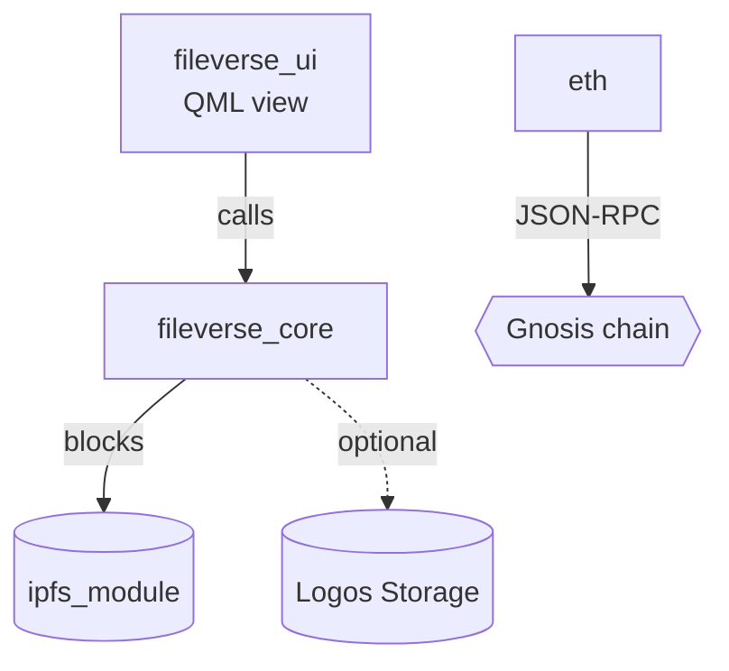

# Fileverse drafts in Basecamp

The Fileverse app in Logos Basecamp keeps **drafts**: documents written in Markdown on
this device, shown in its Drafts list, edited in its visual or Markdown editor,
presented as slides, and published (encrypted, to the user's own IPFS node and Logos
Storage) only when the user presses Publish. A draft is one JSON file; Basecamp re-reads
the drafts directory every few seconds, so a draft you write appears in the user's app,
and a draft they have open is reloaded when you change it.

You work with drafts through `fvdraft.py` (next to this file; Python 3, standard
library only). Do not write draft files by hand.

## Setup

```sh
FV=<this skill's directory>/fvdraft.py
python3 $FV where      # the drafts directories found; the first one is used
```

If nothing is found, the user has not opened the Fileverse app in Basecamp on this
machine (or Basecamp keeps its data elsewhere): ask, and set `FV_DRAFTS=<dir>`. The
directory looks like
`~/.local/share/Logos/LogosBasecamp/module_data/fileverse_core/<hash>/drafts`.
Drafts exist only on the machine where Basecamp runs: if the user's Basecamp is on
another machine, this skill has to run there.

## Workflow

1. **Find the draft.** `python3 $FV list` (newest first: id, title, updatedAt,
   published). Match the user's description to a title; ask if unsure.
2. **Read it.** `python3 $FV show ID > draft.md` and `python3 $FV info ID` (note
   `updatedAt`).
3. **Edit** `draft.md`.
4. **Check it.** `python3 $FV lint --file draft.md`: unclosed fences or columns,
   pictures not kept with the draft, diagram constructs the app draws badly.
5. **Save, with the change check.**
   `python3 $FV save ID --file draft.md --base <updatedAt from step 2>`.
   If it refuses, the user (or something else) changed the draft meanwhile: show it
   again, merge your change into the new text, and save with the new `updatedAt`.
   Never drop their edits to make your save go through.
6. **New document:** `python3 $FV new --title "Title" --file draft.md` prints the new
   id. The title is the draft's name in the list; also start the Markdown with
   `# Title`.

Tell the user what you changed and that it is in Basecamp's Drafts (it appears within
a few seconds; an open draft reloads; if they were typing in it, Basecamp asks whether
to load your version or keep theirs).

## The Markdown the app understands

Plain CommonMark plus tables, task lists and strikethrough, and these:

**Slides** (Present in the app, as Fileverse's presentation mode):
- `#` and `##` headings start a new slide; the content under them goes with them. A
  heading is never left alone at the bottom of a slide.
- A line of only `===` (three or more) ends a slide there. It is not shown.
- The app fits each slide to a 16:9 stage and splits a long one between blocks (list
  items one by one). Columns, tables, pictures and diagrams are never split, so keep
  each of those to what fits on one slide.
- A slide with only headings is a title slide (centred, larger). A slide with only a
  picture or only a diagram gets the whole stage.
- One idea per slide: a heading, three to five bullets or one diagram.

**Columns** (side by side; picture beside text):

```
::: columns align-center
- Text on the left
- More text

::: column


:::
```

Layouts: `align-center` (equal), `align-right` (first column wider), `align-left` (last
column wider). Columns cannot be nested; no code blocks inside a column.

**Pictures** must be kept with the draft (they are encrypted and uploaded on publish):

```sh
python3 $FV add-image ID path/to/picture.png --alt "What it shows"
```

prints a line like ``: put it in the Markdown where the
picture goes, on a line of its own (or in a column). PNG, JPEG, GIF, WebP or SVG, up to
25 MB. Pictures linked from the web (``) are not shown.

**Diagrams**: a code block in the `mermaid` language. The app draws it (no browser, in
its theme) in the document, the preview and on slides; Fileverse draws it too.

````

````

What draws well: `flowchart` / `graph` (`TB` usually lays out better than `LR` for more
than five nodes), node shapes `[box]`, `(rounded)`, `[(cylinder)]` for storage,
`{{hexagon}}`, `((circle))`, `[/slanted/]`, `{decision}`; edges `-->`, `-.->` (dotted),
`==>` (thick), `<-->`, labels `-->|text|`; `<br/>` for a line break in a label;
`subgraph Name ... end`. `sequenceDiagram` with `participant X as Name`, `actor`,
`->>`, `-->>` (reply), `Note over A,B: text`, `alt ... else ... end`. Also pie, class,
state, ER, timeline, mindmap (less tested).

What the app's renderer draws badly (lint warns): `loop` blocks, `autonumber` and a
message from a participant to itself in sequence diagrams (use a `Note over X:` instead),
and `direction` inside a subgraph (ignored). Keep a diagram to about ten nodes per slide.

**Links**: `[text](https://...)` or a bare `https://...` address (made a link). They
open in the browser when clicked (Ctrl+click in the editor).

**Not supported**: HTML, footnotes, math, embedded videos, nested columns.

## Rules

- Only through `fvdraft.py`. Never edit or print a draft's `secret` (the key publishing
  uses), and never change `published`, `links` or `sourceUrl`.
- Never delete drafts. To replace one, write a new draft and tell the user.
- Do not publish: publishing makes the document fetchable by anyone with its link. It
  is the user's button in Basecamp.
- Always save with `--base`, and on a refusal merge rather than overwrite.
- Drafts copied from someone else's Fileverse document (`sourceUrl` set) are the user's
  own copies: editing them changes nothing in the original.
